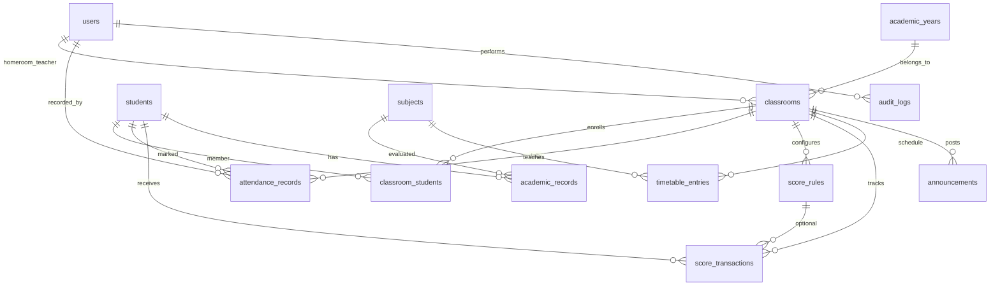

# ERD — Hệ thống quản lý lớp học tiểu học (QLHS)

## Quan hệ chính

## Bảng

| Bảng | Mô tả |
|------|--------|
| `users` | Tài khoản ADMIN / TEACHER |
| `academic_years` | Năm học |
| `classrooms` | Lớp học theo năm |
| `students` | Hồ sơ học sinh |
| `classroom_students` | Ghi danh / chuyển lớp |
| `attendance_records` | Điểm danh theo ngày (unique: lớp + HS + ngày) |
| `score_rules` | Quy tắc cộng/trừ điểm thi đua |
| `score_transactions` | Lịch sử điểm (append-only, hoàn tác qua bản ghi đảo) |
| `subjects` | Môn học (danh mục) |
| `academic_records` | Đánh giá học tập |
| `timetable_entries` | Thời khóa biểu |
| `announcements` | Thông báo lớp |
| `audit_logs` | Nhật ký thao tác |
| `password_reset_tokens` | Token khôi phục mật khẩu (hash) |

## Quy tắc nghiệp vụ

- Điểm thi đua hiện tại = tổng `points_delta` của các giao dịch chưa bị hoàn tác.
- Giáo viên chỉ thao tác lớp do mình chủ nhiệm (ADMIN toàn quyền).
- Xóa mềm: `users`, `classrooms`, `students` (`is_deleted`).
- Lịch sử điểm danh và giao dịch điểm không xóa cứng.
